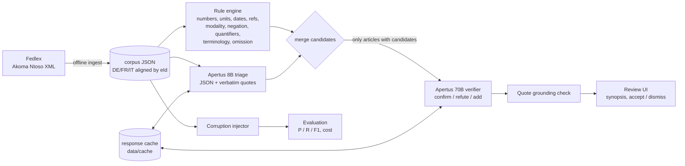

# Architecture



## Where each part runs
| Component | Network at runtime | Notes |
|---|---|---|
| Ingest (`concordance ingest`) | Fedlex | One-off, offline from the detector. Output is a plain JSON corpus. |
| Rule engine, evaluation, UI | none | Pure Python, standard library plus matplotlib. |
| Apertus calls | CSCS endpoint **or** local server | `replay` mode needs no model at all (cached answers). |

## Deployment targets (Track 2B requirement)
**Air-gapped.** `make run` starts the container with `--network none` and replays recorded
model answers: nothing leaves the machine. For fresh analysis inside an air-gapped site, serve the
weights locally and point the tool at them:

```bash
# on the GPU host (weights already on disk; check your vLLM version supports Apertus)
vllm serve swiss-ai/Apertus-8B-Instruct-2509 --port 8000
vllm serve swiss-ai/Apertus-70B-Instruct-2509 --port 8001 --tensor-parallel-size 4
# tool side: any OpenAI-compatible URL, no key needed for a local server
CSCS_BASE_URL=http://gpu-host:8000/v1 APERTUS_LARGE_BASE_URL=http://gpu-host:8001/v1 \
  python -m concordance analyze
```
`CSCS_BASE_URL` serves the small model (and the large one unless `APERTUS_LARGE_BASE_URL` is set).

**On-premise.** Same container and the same two model servers, inside the organisation's network.
Legislative drafts never leave it.

**Sovereign Swiss cloud.** The CSCS Alps endpoint used for development is operated in Switzerland.

## Cost model
The cascade sends only articles with candidates to the 70B model. Cost is reported in
"8B-equivalent tokens" (70B tokens weighted 70/8, a parameter-proportional proxy, not a price).
